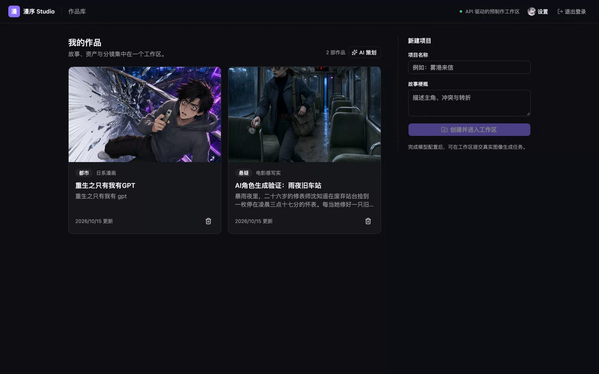
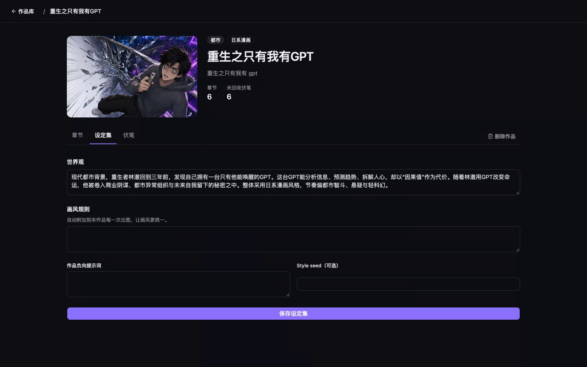
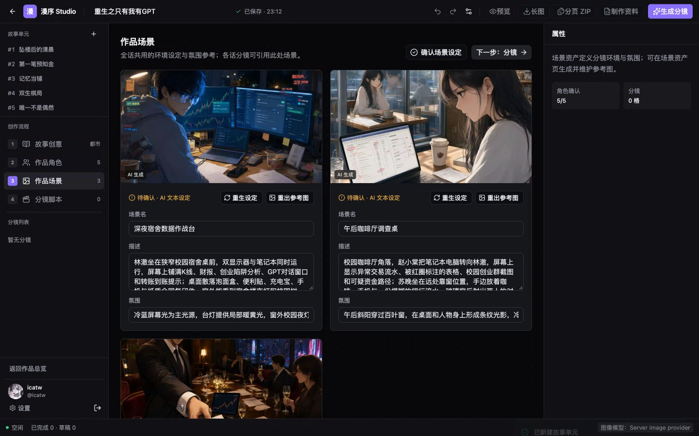
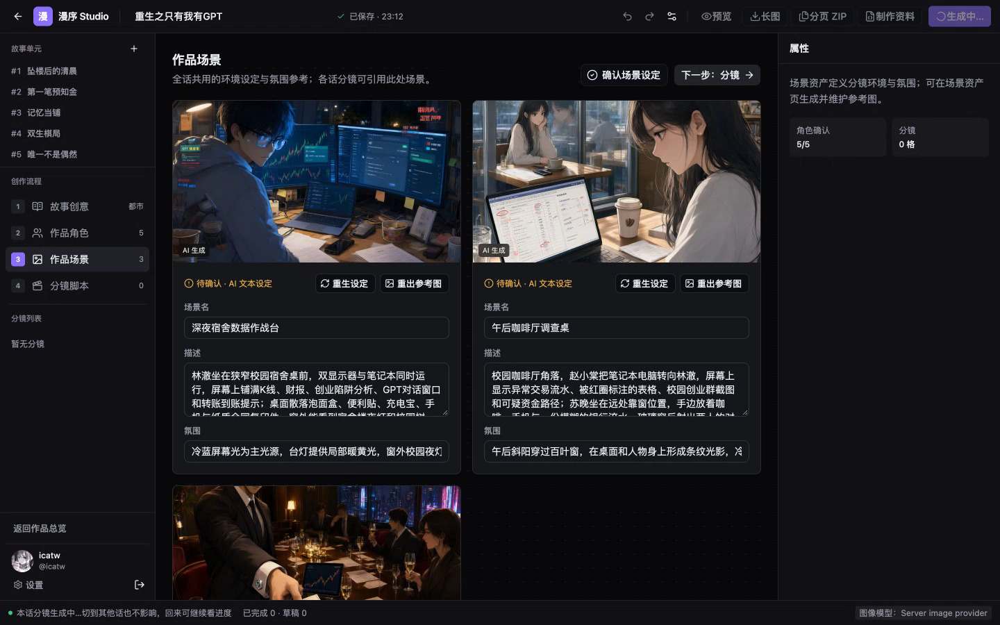

# 漫序 Studio

面向独立漫剧创作者和小型工作室的 **AI 漫剧预制作工作台**。

把故事创意推进成可编辑、可复用、可导出的材料：角色定妆、场景设定、结构化分镜、画面生成与局部重绘，以及多话连载的连续性管理。

<p align="center">
  
</p>

## 演示

| 材料 | 说明 |
| --- | --- |
| [演示录屏（约 3–4 分钟）](docs/media/demo-walkthrough.mp4) | 产品判断 + 主路径走查（含字幕） |
| 完整版 | `demo/out/manxu-studio-demo-final.mp4`（同源更高码率） |

本地也可直接打开：

```sh
open docs/media/demo-walkthrough.mp4
```

## 产品能力

- **账户**：邮箱验证码登录 / GitHub OAuth；项目与生成任务按账户隔离
- **作品与连载**：作品库、AI 季策划、多话切换、设定集、伏笔、话摘要前置
- **创作主路径**：故事 → 角色 / 场景（定妆锁定）→ 分镜 → 出图 → 预览
- **导出**：本话长图 / 分页 ZIP；作品总览合集 ZIP / PDF
- **模型**：账户可配置文本与图像模型；密钥服务端加密保存

### 界面一览

| 作品库 | 作品总览 |
| --- | --- |
|  |  |

| 工作室（角色 / 场景） | 阅读页 |
| --- | --- |
|  |  |

### 建议体验路径

1. 打开 `http://localhost:5173`，用邮箱验证码登录（本地验证码在 Mailpit：`http://localhost:8025`）
2. 创建作品或打开已有作品 → 总览查看章节 / 设定集 / 伏笔
3. 进入工作室：写故事 → 生成角色场景 → 分镜出图
4. 预览后导出长图或分页 ZIP；多话时先写好上一话摘要再续写

## 技术栈

| 层 | 选型 |
| --- | --- |
| 前端 | React、TypeScript、Vite、React Router、TanStack Query、Tailwind、shadcn/ui |
| 后端 | Python 3.13、FastAPI、SQLAlchemy async、Alembic、uv |
| 数据 / 队列 | PostgreSQL、Redis、ARQ worker |
| 契约 | `docs/api/openapi.yaml`（人工维护；前端类型由此生成） |
| 部署 | Docker Compose + Caddy（生产 overlay） |

## 本地启动

要求 Node.js 22.12+、pnpm 11.8+、uv、Docker Compose。

### 一键启动

```sh
./scripts/start.sh
```

会创建缺失的 `.env`，构建并启动 PostgreSQL、Redis、Mailpit、API、worker、前端。停止：

```sh
./scripts/stop.sh
```

浏览器打开 [http://localhost:5173](http://localhost:5173)。前端 Nginx 将 `/api` 反代到 API；Mailpit 收件箱在 [http://localhost:8025](http://localhost:8025)。

### 分进程开发（可选）

1. 复制 `.env.example` 为 `.env`，配置 `MODEL_ENCRYPTION_KEY`（可用 `openssl rand -hex 32`）及可选 GitHub OAuth。
2. `docker compose --profile local up -d postgres redis mailpit`
3. `uv sync --directory backend` → `uv run --directory backend alembic upgrade head`
4. `pnpm --dir frontend install`
5. 分别启动：

```sh
uv run --directory backend fastapi dev app.main:app
uv run --directory backend arq app.worker.WorkerSettings
pnpm --dir frontend dev
```

## 生产部署（单机 VPS）

```sh
cp .env.prod.example .env.prod
# 填写 DOMAIN、HTTPS URL、POSTGRES_PASSWORD、MODEL_ENCRYPTION_KEY、
# EMAIL_CODE_PEPPER、真实 SMTP
./scripts/deploy.sh
```

说明见 [`docs/delivery/deploy-vps.md`](docs/delivery/deploy-vps.md)。  
若主机已有 nginx 占用 80/443（如共用腾讯云机），用 nginx 边缘方案，**不要起 Caddy**：见 [`docs/delivery/deploy-tencent-nginx.md`](docs/delivery/deploy-tencent-nginx.md) 与 `docker-compose.prod.nginx.yml`。

## 检查

- `make check`：OpenAPI lint、类型生成、前后端 lint / typecheck
- `make test`：前后端自动化测试
- `make migrate`：Alembic 迁移
- `make check-prod-env`：校验 `.env.prod`

## 仓库结构（简图）

```
frontend/          React 应用
backend/           FastAPI + worker
docs/              产品 / API / 架构文档；media/ 为截图与演示视频
demo/              汇报讲稿、旁白与录屏合成脚本
deploy/            Caddyfile 等
scripts/           start / deploy / check
.harness/          当前阶段与计划
```

## 更多资料

- 产品与技术文档索引：[`docs/README.md`](docs/README.md)
- 当前阶段与计划： [`.harness/status.md`](.harness/status.md)
- 接口契约流程：[`docs/api/README.md`](docs/api/README.md)
- 演示录屏重做：[`demo/README.md`](demo/README.md)
